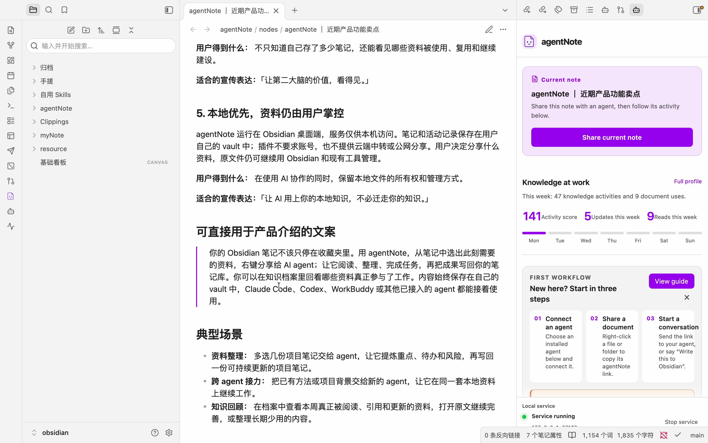
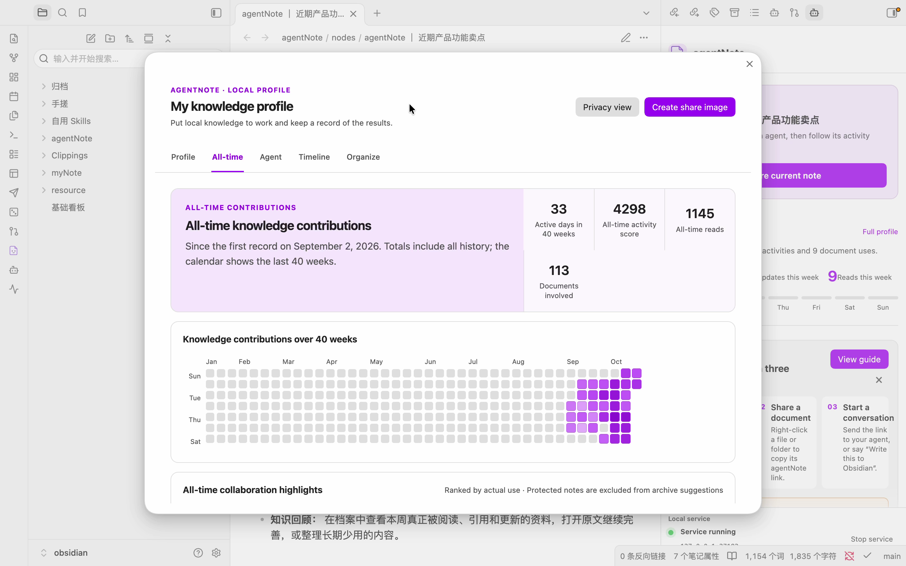

**English** · [简体中文](README.zh-CN.md)

# agentNote

[Product website](https://agentnote-intro.app.workbuddy.host/)

**Let your notes go to work. Bring the results home.**

Your Obsidian vault holds more than information: it holds your methods, project history, and the decisions you have already made. agentNote lets that knowledge take part in an AI agent's work—and lets the work become knowledge you can use again.

It is a local Obsidian desktop plugin for sharing material with agents such as Claude Code, Codex, and WorkBuddy, and writing their results back to your own notes.

*Sharing local knowledge from the Obsidian workspace.*

## A second brain that participates

Saving more notes is only the beginning. Their value grows when a past decision informs today's plan, a method guides a new task, or a project brief gives an agent the context it was missing.

With agentNote, you choose the material that matters and share it from Obsidian. A note, a folder, or a passage can become the starting point for research, writing, or planning. Connected notes can help the agent follow the ideas behind it.

You direct the context. The agent works with it.

## Knowledge outlasts the conversation

A useful result should have a life beyond the chat where it was created. Ask an agent to save its conclusions to Obsidian, and they become ordinary Markdown notes: editable, connected to your other material, and ready for the next task.

That creates a simple cycle: **existing knowledge → agent work → new knowledge**. Each conversation can build on what came before. Changing agents does not require starting your working memory from scratch.

## See what your knowledge contributes

A growing vault can make it hard to tell what is useful. agentNote's knowledge profile makes the activity visible: which documents were read or developed, which agents used them, and when the work happened.

Follow a document's records back to the timeline, revisit the original note, or decide what to protect and what to archive. The goal is to help you keep useful knowledge alive. Activity values describe recorded actions; they are not a judgment of the quality of your work.

*Knowledge contributions over time. The figures shown are from a personal vault.*

## Your knowledge stays yours

Your files and activity records stay in your vault. agentNote adds a local bridge to your existing workflow, without asking you to move your knowledge into another platform or create a cloud account.

You keep using Obsidian to edit and organize your notes, and your preferred agent to do the work. agentNote does not upload your vault; material you give an agent is still processed according to that agent and its provider.

## Try it with one real task

Connect an agent, share a piece of useful context, and ask it to save the result back. For example: “Use these project notes to draft the next steps, then write the plan to Obsidian.”

[Install the latest release](https://github.com/xinxinrana/agentNote-Obsidian-/releases/latest) · [Follow the illustrated guide](docs/How%20to%20Use.md)

Requires **Obsidian desktop 1.8.7 or later** on macOS, Windows, or Linux. Share links work on the same computer while the vault's local service is running. On macOS, hide Obsidian with **⌘H** or minimize it while your agent works; closing the vault window stops the service.

[Features and usage](docs/Features%20and%20Usage.md) · [Product philosophy](docs/Product%20Design.md) · [Report an issue](https://github.com/xinxinrana/agentNote-Obsidian-/issues)

For contributors: [Development](docs/Development.md) · [Git activity sync](docs/Git%20Activity%20Sync.md) · [Brand assets](assets/brand/README.md)

[MIT License](LICENSE) · Evan · [GitHub](https://github.com/xinxinrana)
