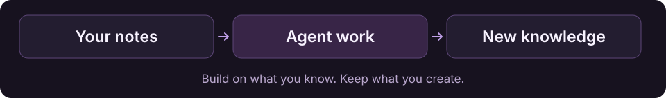
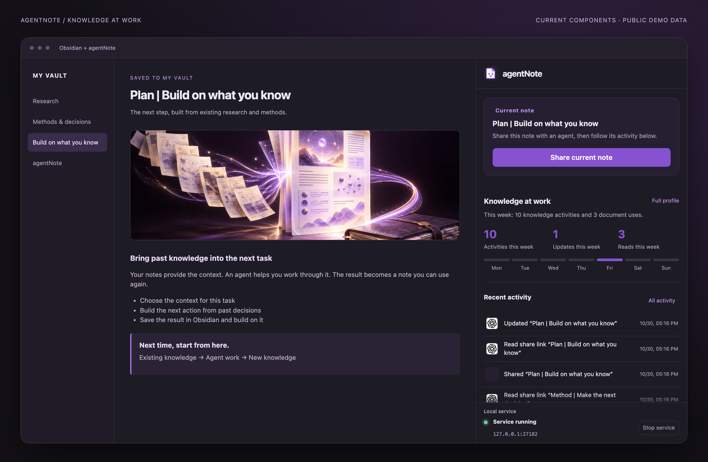
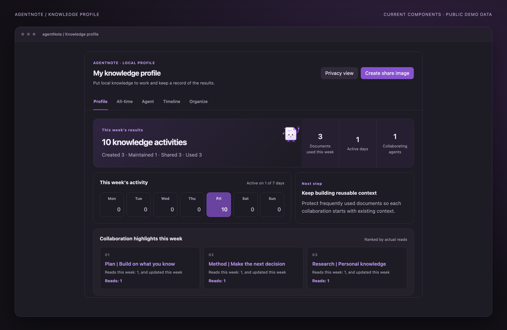

  <picture>
    <source media="(prefers-color-scheme: dark)" srcset="assets/brand/agentnote-lockup-dark.svg">
    
  </picture>

<strong>Let your notes go to work. Bring the results home.</strong> Use what you learned before. Keep what you create today.

  
  
  

<a href="https://community.obsidian.md/plugins/agentnote">Install</a> · <a href="docs/How%20to%20Use.md">Get started</a> · <a href="https://agentnote-intro.app.workbuddy.host/">Website</a> · <a href="README.zh-CN.md">简体中文</a>

Build on what you know. Keep what you create. Concept artwork, not a software interface.

agentNote is an Obsidian desktop plugin. Share a note, a folder, or a passage with agents such as Claude Code, Codex, and WorkBuddy. Let them work with your context, then save the results back to your vault.

## Put what you know to work

The method you kept refining. The decision from your last project. The idea you wrote down and never returned to. Each can become the starting point for your next task.

Choose the material that matters, right-click to share it, and send the link to your agent. It reads the current content and can follow wikilinks for related context. You choose the background; the agent builds on it.

## Keep the work beyond the conversation

When a conversation produces something worth keeping, just ask:

> Use these research and method notes to plan the next steps, then write the plan to Obsidian.

The result becomes an ordinary Markdown note in your vault. Edit it, connect it to other notes, hand it to another agent, or use it in your next task. “Update the note we just made” continues work on the same note.

From existing material to a new note. Interface demonstration with public sample content.

## See the work your knowledge takes part in

Your knowledge profile records which notes were read or developed, which agents used them, and when. Follow an activity back to the original note, keep building on it, or organize material you no longer use.

Activity counts describe recorded actions, not the quality of the work. Figures shown are demo data.

## Start with one real task

1. **Install and enable.** Search for **agentNote** in Obsidian Community plugins. Open the agentNote panel and check that the local service is running.
2. **Connect an agent.** Click **Connect** and send it the copied installation task. The agent installs the Skill and reports its connection.
3. **Share and keep working.** Right-click a note, choose **agentNote: Share with agent**, and send the link. When you want to keep the result, say “write to Obsidian.”

[Follow the illustrated guide](docs/How%20to%20Use.md) · [Download the latest release](https://github.com/xinxinrana/agentNote-Obsidian-/releases/latest)

## Your material. Your choice of agent.

The panel includes **Claude Code, Codex, and WorkBuddy**. Other agents that support Skills and local HTTP access can use **Connect another agent**.

Your notes and activity records stay in your vault. No agentNote cloud account is required. agentNote does not upload your entire vault; material you give an agent is processed by that agent and its provider.

Requires **Obsidian desktop 1.8.7 or later** on macOS, Windows, or Linux. Share links work only on the same computer. Keep the vault open while your agent works. On macOS, use **⌘H** or minimize Obsidian; closing the vault window stops the service.

---

[Features and usage](docs/Features%20and%20Usage.md) · [Product philosophy](docs/Product%20Design.md) · [Report an issue](https://github.com/xinxinrana/agentNote-Obsidian-/issues)

[Development](docs/Development.md) · [Git activity sync](docs/Git%20Activity%20Sync.md) · [Brand assets](assets/brand/README.md)

[MIT License](LICENSE) · [Evan](https://github.com/xinxinrana)
