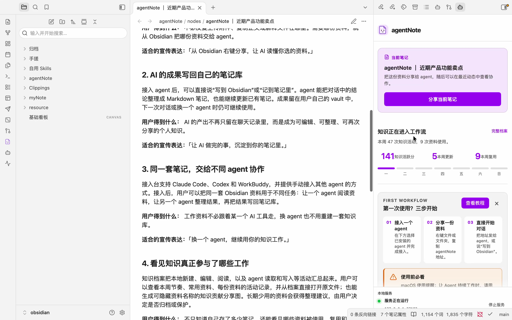
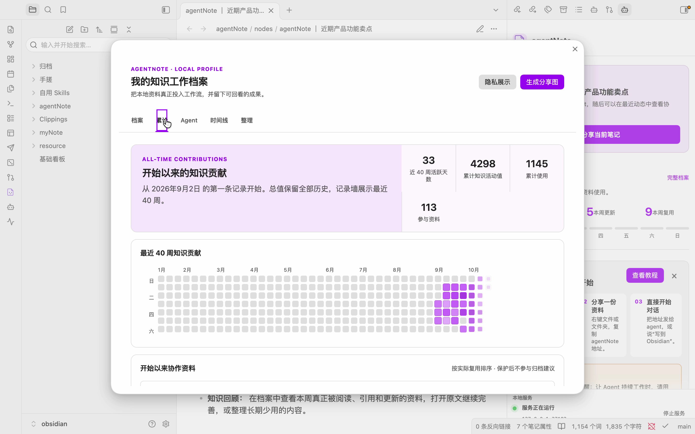

[English](README.md) · **简体中文**

# agentNote

**让笔记去上班，让成果回到笔记里。**

Obsidian 里积累的不只是信息，还有你的方法、项目经历和已经做过的判断。agentNote 让这些知识真正参与 Agent 的工作，也让这次工作的成果，成为下一次可以继续使用的知识。

它是一个本地 Obsidian 桌面端插件：把资料分享给 Claude Code、Codex、WorkBuddy 等 Agent，再把成果写回自己的笔记库。

*在 Obsidian 的工作界面里，让本地资料参与 Agent 工作。*

## 第二大脑，也可以参与工作

存下更多笔记只是开始。当过去的判断能帮助今天做计划，一套方法能指导新的任务，一份项目记录能补上 Agent 缺少的背景，知识才真正发挥了作用。

用 agentNote，你可以从 Obsidian 中选出此刻有用的资料，交给 Agent。它可以是一篇笔记、一个文件夹，也可以只是其中一段内容，成为调研、写作或规划的起点。笔记里的双链，也能让 Agent 沿着已有联系理解相关知识。

你负责指向，Agent 负责理解和执行。

## 知识属于你，不属于某次对话

一个有价值的结果，应该在聊天结束后仍然可用。让 Agent 把结论写回 Obsidian，它就成为普通的 Markdown 笔记：可以编辑、与其他资料连接，也可以再次交给 Agent 使用。

于是，工作形成一个循环：**已有知识 → Agent 工作 → 新的知识**。下一次协作可以接着上一次的成果继续。换一个 Agent，也不用从头重建自己的工作记忆。

## 看见知识真正参与了什么

笔记库越积越多，哪些内容真正有用反而不容易看清。agentNote 的知识档案把这些活动呈现出来：哪些资料被阅读或继续建设，哪些 Agent 使用过它们，工作发生在什么时候。

你可以从一份文档追溯到时间线，回到原笔记继续完善，或决定哪些资料值得保护、哪些可以归档。它帮助你维护仍在发挥作用的知识；活动值只是已记录行为的汇总，不是对工作质量的评分。

*回看知识持续参与工作的轨迹。图中统计来自个人笔记库。*

## 让知识流动，保留自己的掌控

笔记和活动记录仍保存在你的笔记库。agentNote 为已有工作方式搭一座本地桥梁，不要求你把知识迁到另一个平台，也不需要注册云端账号。

你继续用 Obsidian 编辑和整理，用自己习惯的 Agent 完成工作。agentNote 不会上传整个笔记库；交给 Agent 的内容，仍由该 Agent 及其服务商按照各自的方式处理。

## 从一次真实的任务开始

接入一个 Agent，分享一份有用的背景，再让成果回到笔记里。例如：“结合这些项目笔记，整理下一步行动，把计划写到 Obsidian。”

[安装最新版本](https://github.com/xinxinrana/agentNote-Obsidian-/releases/latest) · [查看图文教程](docs/如何使用.md)

支持 **Obsidian 桌面端 1.8.7 或更新版本**，适用于 macOS、Windows、Linux。分享链接在同一台电脑的本地服务运行时可用。macOS 上，让 Agent 工作时请用 **⌘H** 隐藏或最小化 Obsidian；关闭笔记库窗口会停止服务。

[功能与使用](docs/功能与使用.md) · [产品哲学](docs/product-design.md) · [反馈问题](https://github.com/xinxinrana/agentNote-Obsidian-/issues)

开发资料：[开发说明](docs/开发.md) · [Git 活动记录同步](docs/Git活动记录同步.md) · [品牌资产](assets/brand/README.md)

[MIT License](LICENSE) · Evan · [GitHub](https://github.com/xinxinrana)
