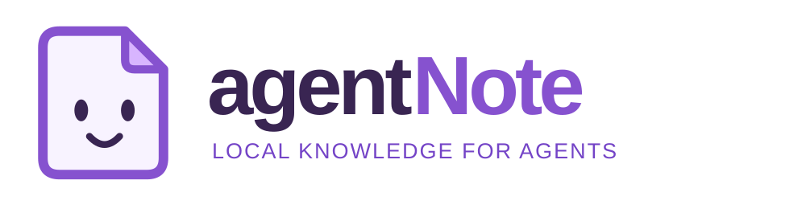
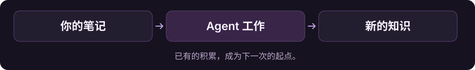
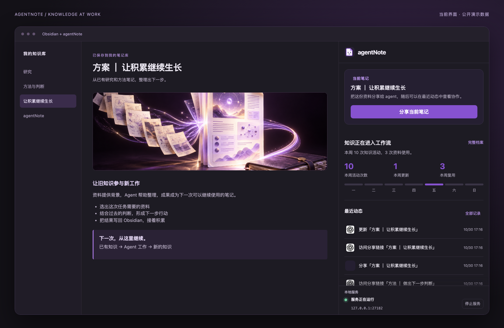
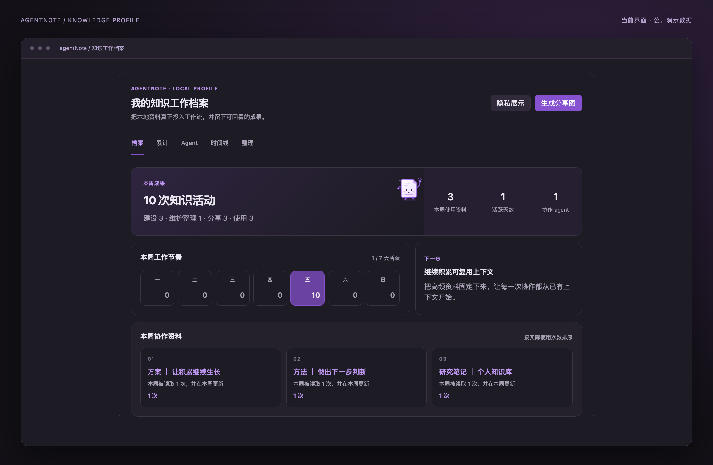

  <picture>
    <source media="(prefers-color-scheme: dark)" srcset="assets/brand/agentnote-lockup-dark.svg">
    
  </picture>

<strong>让笔记去上班，让成果回到笔记里。</strong> 过去的判断，今天用得上。 今天的成果，下次接着用。

  
  
  

<a href="https://community.obsidian.md/plugins/agentnote">安装插件</a> · <a href="docs/如何使用.md">三分钟开始</a> · <a href="https://agentnote-intro.app.workbuddy.host/">产品网站</a> · <a href="README.md">English</a>

让已有的知识，长出新的成果。概念视觉，非软件界面。

agentNote 是一个 Obsidian 桌面插件。把你选中的笔记、文件夹或一段内容交给 Claude Code、Codex、WorkBuddy 等 Agent，让它带着你的背景工作，再把成果写回自己的笔记库。

## 你积累的，终于用上了

那份反复修改的方法、上次项目做过的判断、随手记下却一直没用上的想法，都可以成为这次工作的起点。

选出有用的资料，右键分享，把链接发给 Agent。它读取当前内容，也能按需沿双链寻找相关笔记。你负责指出哪些背景重要，Agent 带着这些背景继续做事。

## 这次做完的，下次还在

对话里有了值得留下的结论，直接说：

> 结合这些研究和方法笔记，整理下一步行动，把方案写到 Obsidian。

成果会成为普通的 Markdown 笔记，留在你的库里。可以继续编辑、建立双链、交给另一个 Agent，或在下次任务中接着使用。说“修改刚才那篇”，也可以继续更新原笔记。

从已有资料到新的笔记。界面演示使用公开示例内容。

## 回头看，知识一直在参与

哪些笔记被读取、继续建设，哪些 Agent 使用过它们，工作发生在什么时候，都可以在知识档案中回看。沿着活动记录打开原笔记，继续完善，或整理已经不再使用的资料。

活动次数记录已经发生的操作，不评价成果质量。图中为演示数据。

## 三步，开始一次真实的工作

1. **安装并启用**：在 Obsidian 社区插件中搜索 **agentNote**，安装并启用，然后打开 agentNote 接入台，确认本地服务正在运行。
2. **接入一个 Agent**：点击“接入”，把复制的安装任务发给它，完成 Skill 安装与上报。
3. **分享，然后继续对话**：右键一份笔记，选择 **agentNote: 分享给 agent**，把链接发给 Agent。需要保存成果时，说“写到 Obsidian”。

[查看图文教程](docs/如何使用.md) · [下载最新版本](https://github.com/xinxinrana/agentNote-Obsidian-/releases/latest)

## 用自己的资料，用习惯的 Agent

接入台提供 **Claude Code、Codex、WorkBuddy** 入口。其他支持安装 Skill 和访问本地 HTTP 的 Agent，可通过“接入其他 Agent”接入。

笔记和活动记录保存在自己的 vault 中，无需注册 agentNote 云端账号。agentNote 不会上传整个笔记库；交给 Agent 的内容，由相应 Agent 及其服务商处理。

需要 **Obsidian 桌面端 1.8.7 或更新版本**，支持 macOS、Windows 和 Linux。分享链接仅供同一台电脑访问，Agent 工作期间请保持笔记库打开。macOS 可使用 **⌘H** 隐藏或最小化 Obsidian；关闭笔记库窗口会停止服务。

---

[功能与使用](docs/功能与使用.md) · [产品哲学](docs/product-design.md) · [反馈问题](https://github.com/xinxinrana/agentNote-Obsidian-/issues)

[开发说明](docs/开发.md) · [Git 活动记录同步](docs/Git活动记录同步.md) · [品牌资产](assets/brand/README.md)

[MIT License](LICENSE) · [Evan](https://github.com/xinxinrana)
